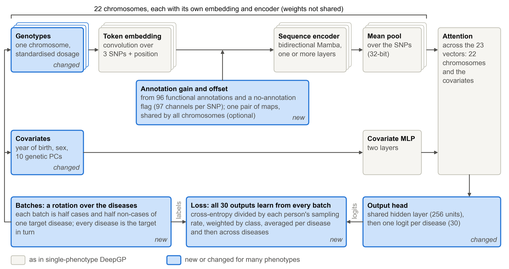

# Methods: WideDeepGP, a multi-disease extension of DeepGP

*DeepWideGP repository, DPhil chapter 6. Written 11–12 November 2026. This document describes
the data, the model and how it is trained. A pilot on real data is reported in
DeepWideGP-Scripts (branch `widening`, `scripts/widedeepgp-pilot/results.md`); what it showed
about the model itself is summarised in section 4.9 and should be read before the model is
trained at full size.*

## 1. Question

DeepGP (Zhu et al., 2025) predicts one disease from genome-wide SNP data with a deep sequence
model: one bidirectional state-space encoder per chromosome, pooled and combined with
covariates. We ask whether one such network can predict many age-related diseases (ARDs) at
once, so that diseases share what the encoders learn, and what has to change in the data, the
network and the training to make that possible. This document covers the model that answers
that question, WideDeepGP, and marks every departure from the single-phenotype model
(section 10).

## 2. Data and phenotyping

### 2.1 Cohort

UK Biobank is a prospective cohort of about 500,000 adults aged 40–69 years at recruitment
(2006–2010) (Sudlow et al., 2015). We used the local extract of application 15181 (18 November
2024; 502,399 participants) and the laboratory's quality-controlled imputed genotypes.

| Step | Participants |
|---|---|
| In the phenotype extract | 502,399 |
| After removing withdrawals (list of 25 April 2024) | 502,165 |
| In the quality-controlled imputed-genotype files | 333,444 |
| Of those: not withdrawn | 333,324 |
| Of those: White-British genetic ancestry (field 22006; Bycroft et al., 2018) | 333,317 |
| Of those: no relative identified in UK Biobank (field 22021 = 0) | **275,872** |

All training, tuning and testing use the 275,872 unrelated White-British participants. Field
22021 = 0 means that UK Biobank's kinship inference found no relative of third degree or
closer among all genotyped participants, so no participant in any split has a relative in
another split.

**Held out and not used.** Labels, covariates and genotypes were prepared with the same
definitions for two further groups, which take no part in training, tuning or testing and are
kept for later validation:

- the 57,445 White-British participants with an identified relative;
- the 9,408 Asian and 7,631 Black participants of the laboratory's second genotype set (17,055
  genotyped, of whom 16 had withdrawn; none lacks a covariate).

### 2.2 Diseases

The prediction targets are 30 phenotypes selected by the analysis `find-ukb-ard-phenos`
(DeepWideGP-Scripts; 11 November 2026), whose `methods.md` gives the full account. In summary:

**Source of the ARD set.** The age-related diseases are the both-sex ARD set of the ardmr
resource: Global Burden of Disease (GBD) causes classified as age-related from trend statistics
of GBD estimates. Its 127 entries map, through GBD's cause-of-death code lists, to 909
three-character ICD-10 categories.

**Candidates.** A later ICD-10 edition moved haemorrhoids from I84 to K64, and in these data
I84 records end and K64 records begin around 2016. The two categories were therefore merged
into one phenotype (a case has either code), leaving 908 candidates.

**Selection.** Eight criteria were applied in a fixed order, and the 30 phenotypes with the most
cases were then kept. Each excluded phenotype is attributed to the first criterion it failed.

| Criterion | Excluded | Remaining | Excluded phenotypes |
|---|---|---|---|
| Candidates | – | 908 | |
| 1. Linked to an age-related GBD cause | 0 | 908 | |
| 2. More than 10,000 cases among unrelated White-British participants | 844 | 64 | |
| 3. Not a sign or symptom (ICD-10 chapter XVIII) | 5 | 59 | R00, R06, R07, R11, R19 |
| 4. Not highly sex-skewed (more than 95% of cases of one sex) | 3 | 56 | C50, C61, N40 |
| 5. Not a residual "other" category | 13 | 43 | B96, E87, I51, K22, K31, K52, K59, K62, K63, K92, M13, M25, M79 |
| 6. Not a record of health-care contact (Z00–Z99, Y40–Y84) | 9 | 34 | Y83, Z50, Z51, Z88, Z90, Z91, Z92, Z95, Z96 |
| 7. GBD code map describes the condition | 1 | 33 | J45 |
| 8. Not an infectious disease | 2 | 31 | J18, J22 |
| 9. The 30 with the most cases | 1 | 30 | J90 |

Criteria 2, 3, 4 and 6 are explicit rules; criteria 5, 7 and 8 are judgements recorded with
their reasons in that analysis. Three phenotypes with imperfect code maps were reviewed there
and kept (C44, N17, I95), and three are predominantly but not exclusively of one sex (K40, 92%
of cases male; M81, 83% female; E03, 79% female).

**The 30 phenotypes**, with cases in each split (section 2.5):

| Phenotype | ICD-10 | Training cases (%) | Tuning cases | Test cases |
|---|---|---|---|---|
| Essential (primary) hypertension | I10 | 68,309 (31.6) | 6,255 | 12,729 |
| Disorders of lipoprotein metabolism and other lipidaemias | E78 | 34,953 (16.2) | 3,153 | 6,378 |
| Diverticular disease of intestine | K57 | 30,506 (14.1) | 2,784 | 5,624 |
| Gastro-oesophageal reflux disease | K21 | 25,427 (11.8) | 2,387 | 4,671 |
| Gastritis and duodenitis | K29 | 24,564 (11.4) | 2,238 | 4,512 |
| Diaphragmatic hernia | K44 | 24,297 (11.3) | 2,271 | 4,524 |
| Chronic ischaemic heart disease | I25 | 23,558 (10.9) | 2,126 | 4,299 |
| Other arthrosis | M19 | 21,544 (10.0) | 1,966 | 4,006 |
| Haemorrhoids | I84, K64 | 21,296 (9.9) | 1,962 | 3,989 |
| Atrial fibrillation and flutter | I48 | 18,365 (8.5) | 1,670 | 3,346 |
| Gonarthrosis [arthrosis of knee] | M17 | 18,227 (8.4) | 1,675 | 3,476 |
| Other malignant neoplasms of skin | C44 | 17,671 (8.2) | 1,676 | 3,303 |
| Non-insulin-dependent diabetes mellitus | E11 | 17,345 (8.0) | 1,663 | 3,143 |
| Obesity | E66 | 16,800 (7.8) | 1,478 | 2,999 |
| Dorsalgia | M54 | 14,550 (6.7) | 1,310 | 2,631 |
| Benign neoplasm of colon, rectum, anus and anal canal | D12 | 14,337 (6.6) | 1,309 | 2,684 |
| Angina pectoris | I20 | 14,234 (6.6) | 1,284 | 2,609 |
| Other hypothyroidism | E03 | 13,242 (6.1) | 1,211 | 2,383 |
| Inguinal hernia | K40 | 12,541 (5.8) | 1,140 | 2,224 |
| Coxarthrosis [arthrosis of hip] | M16 | 12,286 (5.7) | 1,106 | 2,287 |
| Cholelithiasis | K80 | 12,194 (5.6) | 1,118 | 2,253 |
| Acute renal failure | N17 | 11,340 (5.3) | 1,007 | 2,043 |
| Chronic renal failure | N18 | 10,337 (4.8) | 943 | 1,911 |
| Other chronic obstructive pulmonary disease | J44 | 9,884 (4.6) | 986 | 1,906 |
| Internal derangement of knee | M23 | 9,585 (4.4) | 872 | 1,821 |
| Spondylosis | M47 | 9,492 (4.4) | 797 | 1,722 |
| Hypotension | I95 | 9,153 (4.2) | 834 | 1,639 |
| Heart failure | I50 | 8,851 (4.1) | 814 | 1,548 |
| Osteoporosis without pathological fracture | M81 | 8,604 (4.0) | 840 | 1,615 |
| Acute myocardial infarction | I21 | 8,090 (3.7) | 730 | 1,541 |

Haemorrhoids are the union of two categories (see above); every other phenotype is one
three-character category. Training prevalence runs from 3.7% (acute myocardial infarction) to
31.6% (hypertension), with a median of 6.7%. A participant of the training split has 2.5 of
the 30 phenotypes on average: 32% have none, 17% have one and 20% have five or more.

### 2.3 Case definition

A participant is a case for a phenotype if at least one record carries an ICD-10 code whose
first three characters are one of the phenotype's categories, in any of three linked sources:

1. hospital inpatient diagnoses (field 41270), in any diagnostic position of any admission;
2. the death registry, as underlying (field 40001) or contributory (field 40002) cause;
3. the cancer registry (field 40006; the extract holds the first registration only).

Ascertainment is lifetime: records of any date in the linkage period count, so cases include
conditions diagnosed before recruitment and after it. Every other participant is a non-case; no
participant is excluded for having related codes, and no phenotype is restricted to one sex.
The label matrix is built with the code of the selection analysis, and its case counts were
checked to equal that analysis's counts exactly, for all 30 phenotypes, in each of its three
populations (all participants, genotyped White British, unrelated White British).

### 2.4 Covariates

Twelve covariates enter the model, and the polygenic-score comparators are given the same
twelve: year of birth, sex (field 31) and the first ten genetic principal components (field
22009). They are standardised with the training-split mean and standard deviation.

Year of birth is used instead of age at recruitment because case status is ascertained over
the whole linkage period: with follow-up ending on a common date, a participant's age at the
end of follow-up is fixed by when they were born, not by when they happened to be recruited.
Field 34 (year of birth) is not in the extract. It was reconstructed as the date of the first
assessment (field 53) minus age at recruitment in completed years (field 21022) minus one half,
the midpoint of the year in which the birth must lie, so the error is at most half a year.

### 2.5 Splits

The 275,872 participants were split once into 215,872 for training, 20,000 for tuning and
40,000 for testing, by a seeded random permutation of the sorted participant identifiers (seed
20261111). The tuning set decides when training stops, which snapshot is kept and every
hyper-parameter; the test set is scored only after those choices are made, and the scoring
script refuses to read it without an explicit flag and logs each access.

With 20,000 tuning participants the rarest phenotype has 730 tuning cases, which puts the
standard error of its tuning AUROC near 0.011 (Hanley and McNeil, 1982, at an AUROC of 0.6);
the mean over 30 phenotypes is correspondingly steadier.

### 2.6 Limitations of the phenotypes

These are the limitations recorded by the selection analysis that bear on the labels:

- **Hospital-based ascertainment.** Conditions managed mainly in primary care or outpatient
  clinics (for example hypertension, osteoarthritis) are under-ascertained; a non-case may have
  the condition without an admission that records it.
- **Not population prevalence.** Ascertainment depends on follow-up time and birth year, few
  records predate 1997, and UK Biobank participants are healthier than the general population.
- **Partial cancer registry.** Only the first registration per participant is available.
- **ICD-9 records** (field 41271) were not used.
- **Withdrawals** are those of 25 April 2024; later withdrawals must be removed before
  publication.
- **Conservative relatedness filter.** Everyone with any identified relative is excluded,
  not one member of each related pair.

## 3. Genotypes

**SNP set.** The input is the HapMap3+ set of Privé et al. (2023): the 1,054,330 HapMap3
variants used by LDpred2 plus 389,866 variants added to improve tagging, 1,444,196 in all. The
laboratory's genotype files (UK Biobank imputed data v3 as released by Bycroft et al., 2018, on
GRCh37; bi-allelic SNPs, filtered by the laboratory on minor-allele frequency, Hardy–Weinberg
equilibrium and missingness) contain 1,258,200 of them (87.1%), matched by chromosome, position
and both alleles: 1,012,953 of the HapMap3 variants and 245,247 of the added ones. Of the
185,996 that are absent, 116,513 have a minor-allele frequency below 1% in UK Biobank (the files
hold nothing rarer than about 1%) and 69,483 failed the other filters. The model uses all
1,258,200, from 105,260 on chromosome 2 down to 17,844 on chromosome 21.

**No SNP selection.** Published DeepGP chooses its input SNPs separately for each disease, by a
GWAS p-value filter followed by clumping. Here one fixed set serves all diseases: a network
whose encoders are shared between diseases needs one input, and a fixed set also removes any
dependence of the input on the training labels.

**Encoding.** A genotype is the dosage of the alternate allele (0 to 2; imputed dosages kept at
a resolution of 0.01). Each SNP is standardised with its mean and standard deviation in the
training split; a missing genotype is set to the mean. Genotypes are stored in a compact
on-disk format and decoded on the GPU (`genostore/README.md`).

**Annotations.** For the annotated variant of the model (section 4.2), each SNP carries the 96
functional annotations of the baseline-LD model, version 2.2 (Gazal et al., 2017), as
distributed with SBayesRC (Zheng et al., 2024): coding, conserved, regulatory and
histone-mark annotations with their flanking windows, minor-allele-frequency bins, and
continuous measures such as allele age, recombination rate and background selection. The table
covers 1,250,863 of the 1,258,200 SNPs (99.4%); the others get zeros and a 97th channel marking
"no annotation". Each channel is standardised over the model's SNPs.

## 4. Model

The network maps a participant's genotypes and covariates to one logit per disease. Sections
4.2, 4.7 and 4.10 differ in kind from published DeepGP; section 10 lists every difference.

**Figure 1. WideDeepGP.** Each of the 22 chromosomes is a sequence of standardised SNP dosages
with its own token embedding and its own bidirectional state-space encoder; the encoder output
is averaged over the chromosome's SNPs. The covariates pass through a small perceptron. One
attention layer runs across the resulting 23 vectors, and a shared hidden layer feeds one logit
per disease. Stacked outlines mark the parts that exist once per chromosome, with weights that
are not shared between chromosomes. Tinted boxes with a heavy outline are new or changed
relative to single-phenotype DeepGP (tagged "new" or "changed"); plain boxes are as published.
Training draws batches that are balanced on one disease at a time, in rotation, and every
output learns from every batch through a loss that corrects for how often each participant is
drawn. The annotation step is optional and is off in the base model. Its gain and offset are
computed from 96 functional annotations and a no-annotation flag per SNP (97 channels) by one
pair of maps shared by all chromosomes, so that box is drawn once, outside the stack. (Vector
version and the component table: `figures/widedeepgp_architecture.pdf`,
`figures/widedeepgp_architecture_data.csv`; drawn by `scripts/make_architecture_figure.py`.) The
linear PRS path of section 4.10, added on 13 November 2026, is not yet drawn.

### 4.1 Input and token embedding

Each chromosome is a sequence of standardised dosages, one token per SNP, in genomic order. A
token's embedding is the sum of two parts, followed by dropout:

- a **value embedding**: a one-dimensional convolution over the dosage sequence with a kernel
  of three SNPs, from one channel to *d* (the model width), without bias and with circular
  padding, so each token also sees its two neighbours;
- a fixed **sinusoidal position embedding** of the SNP's index along the chromosome, with
  wavelengths in geometric progression (base 10⁶).

### 4.2 Annotation gain and offset (annotated variant)

With annotations switched on, the value embedding of SNP *s* is modified before the position
embedding is added:

    token_s = value_s × (1 + G a_s) + H a_s + position_s

where *a_s* is the SNP's standardised annotation vector and *G* and *H* are linear maps from
the annotations to the model width. The gain lets an annotation scale how strongly a SNP's
genotype enters the network, which mirrors how SBayesRC uses annotations (they change a SNP's
expected effect size); the offset lets it mark the SNP irrespective of genotype. Annotations
describe the SNP, not the person, so the gain and offset are computed once per chromosome and
shared by everyone in the batch. One pair of maps serves all chromosomes, since the meaning of
an annotation does not depend on the chromosome. Both maps start at zero, so the annotated
model starts as the plain model and weights trained without annotations can be loaded into it.

### 4.3 Sequence encoder

Each chromosome has its own encoder of *L* layers. A layer normalises its input (layer
normalisation), passes it through a bidirectional selective state-space block and adds the
result to a residual stream; a final root-mean-square normalisation follows the last layer.

The block is the bidirectional Mamba block of Vision Mamba (Zhu et al., 2024), built on Mamba
(Gu and Dao, 2023), as in published DeepGP. The input is projected to twice the model width and
split into a signal and a gate. The signal passes through a depthwise convolution (kernel 4)
and a SiLU non-linearity and then drives a selective state-space recurrence with 16 states per
channel, whose transition, input and output parameters depend on the token. The recurrence is
run once along the chromosome and once in reverse, and the two outputs are summed, gated and
projected back to the model width. In the variant used ("v1"), the two directions share the
convolution and the projections and differ only in their state matrices. Computation and
memory grow linearly with the number of SNPs, which is what allows a whole chromosome to be one
sequence.

**Mamba-3 (evaluated, not adopted).** Mamba-3 (Lahoti et al., 2026) is implemented as an
alternative block. Upstream Mamba-3 runs in one direction only, so two blocks are used per
layer, one reading the chromosome forwards and one backwards, each with its own weights, and
their outputs are summed. It is in single-input mode with a state size of 16, the state size of
the current block (Mamba-3's default of 128 would add parameters that outweigh the rest of a
block this narrow). At a model width of 32 the pair has 14,980 parameters per chromosome and
layer against the current block's 11,008. Two properties of the upstream implementation matter
here: its kernel computes the recurrence in bf16 whatever the precision of the rest of the
network, so a "32-bit" run with this block is 32-bit everywhere except inside the recurrence;
and its backward pass is incompatible with the checkpointing variant used for the current
block, so its encoders are checkpointed with the re-entrant variant, which gives the same
outputs and gradients. The decision rule was fixed in advance: Mamba-3 replaces the current
block only if it runs at chromosome length and its mean tuning AUROC in the pilot exceeds the
current block's by more than the seed-to-seed spread at equal GPU-hours; otherwise it is
dropped. It ran at chromosome length, with one limit (a call with more than about 122
participants at 105,260 SNPs fails inside the upstream kernel), needed about twice the memory
per participant without checkpointing, and in the pilot gave the same AUROC as the current
block at 1.6 times the training time. It was dropped; the code remains behind `--mixer mamba3`.

### 4.4 Pooling

The encoder's output is averaged over the SNPs of the chromosome, giving one vector of width
*d* per chromosome. Under mixed precision the average is taken in 32-bit floating point
(section 6).

### 4.5 Covariate encoder

The covariates pass through a two-layer perceptron (hidden width 256, ReLU, dropout 0.1) and a
root-mean-square normalisation, giving a 23rd vector of width *d*.

### 4.6 Attention across chromosomes

One transformer encoder layer (multi-head self-attention, a feed-forward layer of width 4*d*,
layer normalisation, dropout 0.1) runs over the 23 vectors, so that the representation of each
chromosome can depend on the others and on the covariates.

### 4.7 Output head

The 23 vectors are concatenated and passed through a linear layer to a shared hidden layer of
256 units (ReLU, dropout 0.1) and a final linear layer with one output per disease. The outputs
are logits; the sigmoid is applied in the loss. Diseases therefore share everything up to the
hidden layer and differ only in the last linear map: 257 parameters per disease.

### 4.8 Parameter counts

Trainable parameters with 30 outputs and 12 covariates, counted from the constructed network.
The number does not depend on the number of SNPs.

| Width *d* | Layers | One sequence block | 22 chromosome encoders | Covariate encoder | Attention layer | Head | Total | Annotation maps |
|---|---|---|---|---|---|---|---|---|
| 32 | 1 | 11,008 | 244,992 | 11,584 | 12,704 | 196,382 | **465,662** | +6,272 |
| 32 | 2 | 11,008 | 487,168 | 11,584 | 12,704 | 196,382 | **707,838** | +6,272 |
| 64 | 1 | 34,816 | 771,584 | 19,840 | 49,984 | 384,798 | **1,226,206** | +12,544 |
| 64 | 2 | 34,816 | 1,537,536 | 19,840 | 49,984 | 384,798 | **1,992,158** | +12,544 |
| 128 | 2 | 120,832 | 5,327,872 | 36,352 | 198,272 | 761,630 | **6,324,126** | +25,088 |
| 256 | 2 | 446,464 | 19,666,944 | 69,376 | 789,760 | 1,515,294 | **22,041,374** | +50,176 |

The chromosome encoders include each chromosome's token embedding (3*d* parameters) and final
normalisation (*d*). The head is the linear layer from the 23 concatenated vectors to the
hidden layer (23·*d*·256 + 256) plus 257 parameters per disease. The annotated variant adds two
maps from the 97 annotation channels to the model width, 2·(97·*d* + *d*) parameters, shared by
all chromosomes.

For reference, the published single-phenotype configuration (*d* = 32, one layer, eight
covariates, one output) has 457,185 parameters. Thirty outputs instead of one add 7,453, and
twelve covariates instead of eight add 1,024.

### 4.9 What tells one SNP from another, and what the pilot showed

The encoders share their weights across the SNPs of a chromosome and their output is averaged
over the chromosome. A SNP-specific effect, with its own size and sign, can therefore enter
only through what distinguishes one token from another: the position code, and the annotation
vector where one is used.

The position code has 32 sinusoidal features at a model width of 32. A linear read-out of it (a
least-squares fit of the effect profile on the code and a constant, with the cut-off that
`numpy.linalg.lstsq` uses with rcond=None for directions that rounding cannot resolve; numerical
rank 10 to 31) reproduces every SNP's own effect when a chromosome has ten SNPs, as in the
synthetic test data of this repository, but only 11 to 17% of the true effect profiles of the
pilot's simulated traits on its GWAS-selected SNPs (26 to 267 per chromosome; a figure that
depends on the cut-off: about 9 to 14% at float32 precision, roughly 20 to 38% if every
direction is kept), 0.3 to 0.4% on all of the pilot's 157,279 SNPs (2,231 to 13,158 per
chromosome), and about 0.05% of an arbitrary effect profile at the 57,000 SNPs per chromosome of
the full dataset (DeepWideGP-Scripts, branch `widening`,
`scripts/widedeepgp-pilot/position_code_capacity.py`). The encoder is not linear, so this is a
heuristic, not a bound. The pilot bears it out:

- On the real labels (157,279 SNPs, 40,000 training participants, six epoch-equivalents, two
  seeds per scheme) every training scheme ended slightly below a logistic model on the
  covariates (the default by 0.0014 in mean tuning AUROC). Permuting the genotypes between
  participants changed nothing detectable in the eight planned schemes (-0.0003 to +0.0003 over
  their 16 runs). In a ninth, added during the pilot, each SNP carried the association
  *z*-scores of the 30 diseases from a GWAS of 165,872 other participants of the training split;
  there permuting cost 0.0004 and 0.0005 of mean AUROC in the two seeds, about a third of the
  0.0014 that a clumped polygenic score from the same GWAS adds to the covariates.
- On traits simulated on the same genotypes, with 20 to 20,000 causal SNPs and a known ceiling
  of 0.78 to 0.85, the network stayed at an AUROC of 0.51 where a clumped polygenic score or
  GBLUP fitted to the same participants reached 0.72 to 0.81. Mamba-3 did the same, and so did
  an annotation that marked the causal SNPs without saying which way each acts.
- Given only the 2,476 SNPs that a GWAS of the training participants selects, the kind of input
  published DeepGP receives, the network learned slowly (0.54 to 0.65 after six
  epoch-equivalents; continued to 30, it was at 0.54 to 0.64 at the end, after a best pass of
  0.55 to 0.68 at 13.5, chosen on the tuning set and so optimistic).
- Given every SNP's signed association *z*-score for each trait as annotation channels, it
  learned on all 157,279 SNPs (0.58 to 0.69 at the end of training). The annotation gain
  multiplies each SNP's dosage, so a signed statistic gives the network what it otherwise
  lacks: a size and a direction for every SNP. The same statistics kept only at clumped lead
  SNPs did not work: a few hundred marked SNPs are averaged away over a chromosome.
- The 96 functional annotations, which carry no direction, made no difference on the real
  labels and little on the simulated traits.

The consequence for the design is that the choice made in section 3, one unselected SNP set
with no per-disease information, leaves the network without the means to learn SNP effects, at
least at the scale tested. Of the ways SNP-specific information could enter (association
statistics as annotation, GWAS-based selection of SNPs, or parameters of its own for each SNP),
the third was chosen on 12 November 2026, keeping all SNPs and no GWAS: the linear PRS path of
section 4.10.

### 4.10 Linear PRS path

The linear PRS path gives the model a parameter of its own for every SNP and disease, beside
the network. For disease *j*

    logit_j = deep_j + b_j + M^(-1/2) Σ_s x_s θ_sj + Σ_k u_k v_kj

where x_s is the standardised dosage of SNP *s* (the input the encoders read), M the number of
SNPs (1,258,200), θ one weight per SNP and disease (37.7 million in all), u the twelve
covariates, v one weight per covariate and disease, b an intercept per disease, and deep_j the
network's output. The model therefore contains a logistic regression on a genome-wide PRS and
the covariates, and the network only has to add what that misses. No GWAS and no SNP selection
are involved: the weights are learned with the rest of the model, from the training
participants alone. The path is computed in 32-bit arithmetic, also when the encoders run in
bf16. Its PRS and covariate weights start at zero and its intercepts at each disease's weighted
base rate, logit(π′_j) (section 5.2); when the path is on, the network's last layer also starts
at zero, so that at the first step the model is the base-rate model and the network adds only
what training gives it. Older weights load with the path at zero.

Three settings of `--wide`: `on`, the default (network and path); `off`, the network alone (the
model of the pilot); `only`, the path alone, with no network (a linear comparator inside
WideDeepGP, trained by the same code; it also runs without a GPU). The path costs 151 MB of
weights (about 0.6 GB of GPU memory with the optimiser's state) and one matrix product per step,
which is negligible next to the encoders. Its penalty and learning rate are described in
sections 5.2 and 6, and how its settings are chosen in section 8.

## 5. Training objective

### 5.1 Batches

Most diseases are uncommon, and a small batch drawn at random often contains no case of the
rarer ones (with 21 participants, 45% of batches hold no case of the rarest phenotype). Batches
are therefore drawn by a **rotation**:

- each batch has a *target* disease; half its participants are drawn from the target's cases
  and half from its non-cases (when the batch size *B* is odd, *B*/2 is rounded to an even
  number of cases and the rest are non-cases);
- one rotation makes every disease the target once, in an order reshuffled at every rotation;
- cases and non-cases of each disease are each visited in shuffled passes, so the cases of an
  uncommon disease recur many times while its non-cases come round once.

An *epoch-equivalent* is as many draws as there are training participants (215,872).

A batch balanced on its target is not balanced for the other diseases. They appear at their
population rate, raised by however much they co-occur with the target. Over a whole rotation,
cases of the rarest phenotype (acute myocardial infarction, 3.7% of the training split) are
7.8% of the participants drawn; the median across phenotypes rises from 6.7% to 11.3%, and
hypertension from 31.6% to 44.8%. No sampler could balance all 30 at once: a participant has
2.5 of the 30 phenotypes on average, and a batch that was half cases for every phenotype would
need 15.

All 30 outputs nevertheless learn from every batch, because a pass through the encoders is the
whole cost of a step and discarding 29 of the 30 labels would waste it. Two consequences
follow, and the loss handles both: the balance between cases and non-cases has to come from
weights, and the people in a batch are not a random sample of the cohort.

### 5.2 Loss

For a batch of *B* participants,

    loss = (1/n) Σ_j [ Σ_k m_kj · c_j(y_kj) · BCE(z_kj, y_kj) / ω_k ] / (B · Z_j)

    c_j(1) = min( ((1 − π_j)/π_j)^γ , w_max ),   c_j(0) = 1
    ω_k    = (1/n) Σ_i [ ρ · y_ki/π_i + (1 − ρ) · (1 − y_ki)/(1 − π_i) ]
    Z_j    = π_j · c_j(1) + (1 − π_j)

where *k* indexes participants and *j* the *n* diseases, *z* is the logit, *y* the label, BCE
the binary cross-entropy, *m* an indicator that the label applies to the participant (always 1
for these 30 phenotypes) and π_j the prevalence of disease *j* in the training split; ρ is the
share of a batch drawn from its target's cases, ½ when *B* is even.

- **ω_k is the sampling rate of participant *k*:** how often the rotation draws them relative
  to drawing people uniformly, computed from the numbers of cases and non-cases that a batch
  actually holds. At an even batch size a participant with none of the 30 phenotypes has
  ω = 0.55, the median participant 0.80, and the 1% drawn most often more than 3.1; the mean
  is 1 by construction. Dividing by ω is importance weighting: in
  expectation over a rotation, the batch sum equals the same average over the training cohort
  whatever the sampler. The rotation then changes how often an example is seen, not the
  function the network is asked to fit. Without it, the batch balanced on one disease is a
  case-control sample for that disease and a distorted sample for every disease that co-occurs
  with it, the situation of secondary phenotypes in case-control studies (Lin and Zeng, 2009;
  Monsees et al., 2009). The correction has a price in efficiency: weighted this way, the
  draws of a rotation are worth 80% as many uniform draws (Kish's effective sample size,
  1/(mean ω · mean 1/ω); Kish, 1965).
- **c_j is the class weight**, which sets how much a case counts relative to a non-case.
  γ = 1 would weight every disease to parity, except that the cap (w_max = 20 by default) holds
  the seven phenotypes with more than 20 non-cases per case at a weight of 20, below parity, and
  γ = 0 leaves the population rate; the default is the square root, γ = ½, which keeps the
  weights of these phenotypes at 5.1 or less where parity would need up to 25.7. Large weights
  on the one or two cases a small batch holds make the gradient noisy.
- **Z_j and the factor 1/n** put every disease on the same scale (each term is a weighted
  average with expected total weight one) and average the diseases equally, so that a frequent
  disease does not dominate the sum.

Because the objective is a class-weighted cross-entropy over the training cohort, a logit on
the population scale is obtained by subtracting log c_j(1). With one disease, uniform sampling
and γ = 0 the loss is exactly that of published DeepGP.

**Ridge penalty of the PRS weights** (section 4.10). The PRS weights carry a ridge penalty,
added to the loss rather than applied as decoupled weight decay, so that the trained PRS
approximates the posterior mode under a normal prior: θ_sj ~ N(0, τ), so that each SNP's effect
on the logit scale has prior variance τ/M and the whole PRS prior variance τ (`--prs_var`,
searched in every run, section 8). For a loss averaged over the N training participants the
posterior mode carries the penalty Σ_s θ_sj² / (2Nτ). The class weights, however, make a
disease's loss as curved as if it held more information than it does: at the base-rate
solution, the weighted loss's curvature is π′(1 − π′), with π′ = π c(1)/Z the weighted share of
cases, against π(1 − π) for the likelihood. The penalty is therefore multiplied by

    r_j = π′_j (1 − π′_j) / (π_j (1 − π_j)) = c_j(1) / Z_j²,

which restores the shrinkage a disease's real information calls for: from 1.11 for
hypertension (31.6%) to 3.82 for myocardial infarction (3.7%), geometric mean 2.53. The penalty
is averaged over diseases, as the loss is:

    penalty = (1/n) Σ_j r_j ‖θ_j‖² / (2Nτ).

The sampling-rate correction does not change it (the expected loss is the cohort's); the
covariate weights and intercepts are not penalised. N is the run's own number of training
participants, so the shrinkage grows as the training set shrinks. The test
`test_the_penalty_correction_is_the_curvature_ratio` checks the curvature ratio numerically at
three prevalences.

### 5.3 Variants kept for comparison

Three switches exist so that the choices above can be tested rather than assumed: uniform
(shuffled) batches with the same loss; the loss without the sampling-rate correction; and a
"target-only" loss in which only the disease a batch was balanced on learns from it.

## 6. Optimisation

- **Optimiser.** AdamW (Loshchilov and Hutter, 2019) with a constant learning rate by default,
  as in published DeepGP; a linear warm-up and cosine decay are available.
- **Batch size and accumulation.** The batch is bounded by GPU memory, which grows with batch
  size times number of SNPs. Gradients can be accumulated over several batches per update; the
  rotation order is reshuffled every rotation so that the same diseases do not always share an
  update.
- **Mixed precision.** The encoders can run in 16-bit (bf16) arithmetic, and since the pilot
  this is the setting for full-size runs. Pooling, the head and the loss always run in 32-bit:
  participants differ by under 2% of a pooled chromosome vector, which is finer than bf16
  resolves. In a forward probe with random weights and inputs at 87,521 SNPs, averaging in bf16
  distorted the between-participant part of the pooled vector by about 10%, and averaging the
  same activations in 32-bit by 0.3%. In the pilot, bf16 encoders gave the same mean tuning
  AUROC as 32-bit ones (0.6594 against 0.6593 over two seeds) in 0.81 times the training time
  and 0.62 times the peak GPU memory, at up to 13,158 SNPs per sequence. At full length (105,260
  SNPs on chromosome 2), 200 steps from the same seed and batches gave the same training loss to
  within 0.2% at every logged step and the same mean tuning AUROC (0.6110 against 0.6108), in
  0.74 times the time per step (0.76 in the capacity trials, which had a GPU to themselves) and
  0.59 times the peak memory; a whole run has not been compared.
- **Activation checkpointing.** Each chromosome's encoder can be run without storing its
  intermediate activations, which are recomputed during the backward pass. Outputs and
  gradients are unchanged; memory is then set by the longest chromosome instead of the genome,
  at the cost of one extra forward pass.
- **Seeds.** Every run uses one seed, 1: it sets the initial weights, dropout and the order
  of the batches, and the sampler of the hyper-parameter search. The pilot, its simulated-trait
  control and its hyper-parameter search ran with it (the pilot's arms also once with seed 2,
  to measure seed-to-seed spread). The published single-disease code keeps its default of 33.
  The train/tune/test split was drawn once, with seed 20261111 (section 2).
- **Learning rate of the PRS weights.** With Adam each weight moves by about its learning
  rate per step whatever the size of its gradient, so for 37.7 million PRS weights the rate
  sets how much noise they keep around the penalised optimum, and the network's rate (about
  10⁻³) would leave the PRS mostly noise. The rate is therefore set by
  lr_θ = κ τ √B / (r̄ √M), with B the effective batch size and r̄ the geometric mean of the
  r_j; under this rule the noise depends on κ alone, and the weights settle in about 1/κ
  epoch-equivalents whatever the training size, the number of SNPs or the batch size (derived
  from Adam's per-weight step, and checked by simulation in the design review; κ about 0.03
  for long runs). κ (`--wide_kappa`) is searched in every run. The PRS weights, the covariate
  weights with the intercepts, and the network form three parameter groups of one AdamW
  optimiser: the network keeps its learning rate and weight decay, the other two have no
  decoupled weight decay (the PRS weights have their ridge penalty instead).

**Measured at full size** (one 48 GB GPU; model width 32, one layer; 1,258,200 SNPs; the
analysis `widedeepgp-pilot` in DeepWideGP-Scripts, branch `widening`). The largest batch is 21
participants in 32-bit, 36 with bf16 encoders, 69 with checkpointing and 130 with both;
annotation vectors lower the 32-bit limit to 19. One epoch-equivalent takes 4.7 GPU-hours in
32-bit and 3.6 with bf16 encoders, and checkpointing costs about a quarter of the speed. The
network is fastest at batches of 8 to 16, so larger batches give fewer and larger updates, not
more throughput. A validation pass over the 20,000 tuning participants takes 7 to 10 minutes,
about 3% of an epoch-equivalent, so four passes per epoch-equivalent add about a tenth to the
training time. The per-SNP means and standard deviations of the training split are computed in
one pass over its genotypes (ten minutes) and cached with the dataset.

## 7. Model selection and snapshots

- **Validation.** Four times per epoch-equivalent, but at most once per 20,000 participants
  seen and at least once per epoch-equivalent, every output is scored on the whole tuning set:
  AUROC, average precision, and cross-entropy on the population scale. (A pass over the 20,000
  tuning participants costs 7 to 10 minutes at full size whatever the training size, so small
  training sets would otherwise spend most of their time validating.) Metrics are computed
  over all tuning participants at once, never per batch.
- **Stopping and the model kept.** Training stops when the mean AUROC across diseases has not
  improved for eight validation passes, or after 30 epoch-equivalents and at least 128,000
  participants seen (about 2,000 updates of 64). The checkpoint with the best mean tuning AUROC
  is the trial's model; section 8 says which trial is the run's.
- **Snapshots.** The weights are also saved at steps evenly spaced on a logarithmic axis (six
  per tenfold increase; eight in the pilot) and at every epoch-equivalent, at most 40 per trial
  (the regular ones are thinned first), with the number of updates, participants seen and
  training time of each. After a run's search only the chosen trial and the first stage's best
  keep their weights; every trial keeps its records. Every snapshot can be scored afterwards, which gives
  performance as a function of training compute, and allows the best snapshot to be read off
  for each disease separately as a secondary analysis.
- **Fixed tables are not saved.** Position tables and annotation matrices are functions of the
  SNP list and are rebuilt from the dataset; a saved model holds its weights and its
  configuration, with a digest of its positions and of its annotation matrices, and refuses to
  load against tables that differ from those it was trained with (an annotated model saved
  before the annotation digest was added, such as the pilot's annotation and GWAS-annotation
  runs, loads with a warning).
- **Continuing a search.** Rerunning a run's command continues its search: finished trials
  are kept, trials that a crash left running are replaced, and a search continued with other
  arguments than it was started with is refused (only the number of trials may grow).
- **Resuming, and starting from saved weights.** `--resume` continues a run from its last
  checkpoint (`last.ckpt`, or the highest `last-vN.ckpt` where Lightning wrote one, as in a run
  directory the pilot's code copied and resumed); a copy of a run directory (made while nothing
  writes to it), or the same directory reached by another path, is resumed as if in place,
  keeping its best checkpoint and best score. It refuses a checkpoint trained on other
  positions, annotations, diseases or training labels, or with other model, loss or optimiser
  settings, and a run whose `config.json` records other batches, seed, schedule or input
  scaling: the loss's constants and the optimiser's state are restored from the checkpoint and
  would silently override new values, and the resumed run's `config.json` replaces the first
  one. Only the planned length may change (the epoch-equivalent budget and the early-stopping
  patience), besides how the run is executed (activation checkpointing, data-loading workers,
  the validation batch size). `--init_from` starts a new run from saved weights; the output
  layer starts afresh when the source was trained for other diseases: a different number, or,
  when the source records its diseases (every WideDeepGP snapshot and checkpoint does), other
  names or another order. A single-disease model saved by `main_genome.py` records none, so a
  one-disease run loads its output layer as it is.

## 8. Hyper-parameter search

Every run tunes itself (Robert's decision of 12 November 2026): the best settings change with
the size of the training set, which the scaling study varies. A run, for one dataset and
training set, is a search in two stages, each a set of ordinary training runs (trials) proposed
by Optuna's tree-structured Parzen estimator (Akiba et al., 2019) and scored by their best mean
tuning AUROC:

1. **The linear model alone** (`--wide only`; 8 trials by default). Searched: the PRS prior
   variance τ (10⁻² to 30, log scale), the pace κ of the PRS weights (0.01 to 0.3, log scale)
   and the learning rate of the covariate weights and intercepts. Batches of 256, one validation
   per epoch-equivalent and twice the run's budget of epoch-equivalents (60 by default), with
   no pruning: the PRS weights settle slowly, so early validations would judge them unfairly.
2. **The network on top** (`--wide on`; 12 trials). Every trial starts from the first stage's
   best linear model with its PRS weights fixed (the covariate weights and intercepts keep
   learning) and searches the network's learning rate, weight decay and embedding dropout.
   Asynchronous successive halving (Jamieson and Talwalkar, 2016; Li et al., 2020) stops the
   trials whose mean tuning AUROC trails at each rung.

The run's model is the second stage's best trial if its mean tuning AUROC is strictly higher
than the first stage's best, and the first stage's otherwise, so the network is reported only
where it adds to the linear model. Every run therefore also yields the linear model's result
at its training size. With `--wide off` the search is the second stage alone, without the
linear path; with `--wide only`, the first stage alone. Trials use the run's seed; each
worker's sampler is seeded with the run's seed plus the worker's index. Trials run in parallel,
one per GPU, on the free GPUs minus one (`--tune_gpus auto`), or one after another without a
GPU. Model width, depth, the sequence block and the use of annotations are experimental factors
and are never searched.

The search inside every run replaces the plan's search on a proxy followed by a comparison at
full size. In the pilot, on the network alone, a search on the real labels of the proxy was
uninformative: every training scheme ended slightly below a logistic model on the covariates
(section 4.9); and an eleven-trial search on the simulated-trait control (one trial completed,
nine pruned, one stopped by hand), on GWAS-selected SNPs, found no setting that learned faster
than the pilot's settings.

## 9. Evaluation outputs

For any snapshot and split the scoring script writes, per disease: AUROC, average precision and
population-scale cross-entropy; the same for a logistic model on the twelve covariates alone,
fitted on the training split; and the difference between the two AUROCs. Per-participant scores
are written only on request and only beside the dataset. Comparisons with polygenic scores,
confidence intervals and calibration are outside this document.

## 10. What changed from single-phenotype DeepGP

| Component | Single phenotype (published) | Multi-phenotype (this model) |
|---|---|---|
| SNPs | Chosen per disease: GWAS p-value filter, then clumping | One fixed set for all diseases: 1,258,200 HapMap3+ SNPs |
| SNP effects | Learned by the network from the selected SNPs | A linear PRS path inside the model (one weight per SNP and disease, ridge penalty) with the network on top; the network is kept only where it adds (section 8) |
| SNP annotations | None | Optional per-SNP annotation vectors as a gain and offset (96 functional annotations; not adopted after the pilot, see section 4.9) |
| Labels | One per participant | One per disease per participant |
| Covariates | Eight | Year of birth, sex, ten principal components |
| Sequence block | Bidirectional Mamba | The same (Mamba-3 in a bidirectional wrapper was evaluated and not adopted) |
| Output | One sigmoid probability | 30 logits from the same hidden layer |
| Batches | Shuffled | Rotation of disease-balanced batches |
| Loss | Binary cross-entropy | Cross-entropy corrected for sampling rate, weighted by class, averaged per disease and then across diseases |
| Validation metric | Mean of per-batch AUROCs | AUROC of each disease over the whole tuning set; their mean for stopping |
| Validation schedule | Every 300 batches | Four times per epoch-equivalent, but at most once per 20,000 participants and at least once per epoch-equivalent |
| Saved models | The best | The best, the last, and snapshots along training |
| Hyper-parameters | Set by hand | Searched inside every run with Optuna: the linear model first, then the network on top |
| Precision and memory | 32-bit; all chromosomes' activations held | bf16 encoders with 32-bit pooling, head and loss (adopted for full-size runs after the pilot); optional per-chromosome checkpointing |

**Unchanged:** the dosage input and its standardisation, the convolutional and positional
embedding, the per-chromosome encoders and their block, mean pooling, the covariate encoder, the
attention layer across chromosomes, the shared hidden layer, and the AdamW optimiser. With one
disease, the same weights give the same output as the published network to within 10⁻⁶, and
the same random seed gives identical initial weights.

## 11. Departures from the published implementation, and known quirks

The single-phenotype code (`models/`, `layers/`, `utils.py`, `main_genome.py`) is left as
published, apart from fixes for the installed software versions, labels coded 0/1 instead of
1/2 (April 2026) and the option to read the genotype store. Four of its properties are
deliberately reproduced, so that the comparison with the published model is like for like:

- The published model's weight-initialisation call runs before its layers exist and has no
  effect; weights keep the default initialisation of their layers. WideDeepGP does the same.
- The published configuration does not pass `--bi_direct`, which selects the "v1" bidirectional
  variant described in section 4.3, not a one-directional model.
- `--dropout` sets the embedding dropout only; the dropout of the covariate encoder, attention
  layer and head is fixed at 0.1.
- The convolution of the value embedding uses circular padding, so the first and last SNP of a
  chromosome are treated as neighbours.

Two published options do not run: the parser's default pooling (`--final_pool concat`) and the
SNP-only mode (`--dm snps`), which names a class that is not in the repository. WideDeepGP does
not offer them either: its entry points replace `concat` with `atten`, the pooling of the
published configuration (`mean` and `last` are also supported), and training stops with an
error when a model without covariates is asked for (`--dm snps`, or `--use_cov`, which switches
the covariates off) or the dataset names no covariates.

## 12. Tests

`tests/test_ml_*.py` check, among other things, that: only named label and covariate columns are
read; the rotation sampler draws each participant at exactly the rate ω that the loss divides
by, for odd batch sizes too; the expected batch loss under the rotation equals the cohort loss
with the correction and differs without it; published weights give the published output;
checkpointing leaves outputs and gradients unchanged; a resumed run continues the same batches,
and a checkpoint trained differently is refused; and saved models hold no fixed tables. Learning
checks train for a few minutes each: one disease on the published smoke-test data must land in
the published AUROC band, and on a synthetic six-trait dataset the heritable traits must be
learned, the rare one included (2% prevalence), while a trait with no genetic signal that
co-occurs with a heritable trait must stay within an AUROC of 0.40 to 0.60; with annotation
vectors that mark the causal SNPs the model must reach the higher bands of annotated runs. The
bands are computed from five training seeds (`scripts/multilabel_synthetic_seeds.csv`): the
lowest seed minus the larger of 0.04 and 2.5 seed standard deviations. `tests/test_ml_mamba3.py`
checks the Mamba-3 wrapper in its own environment: one block reads in one direction only, the
pair reads both ways, and reversing the input while exchanging the two blocks' weights reverses
the output. With the Mamba-3 block the six-trait synthetic run passed the same bands as with the
current block; this was the last of the five gates Mamba-3 had to pass before the pilot (record:
`/mnt/sdg/robert/deepwidegp/runs/gate_evidence/multi6_mamba3_gate5`).

## 13. Software and reproduction

Python 3.10, PyTorch 2.10, PyTorch Lightning 2.0.8, `mamba_ssm` 1.1.1 from the Vision-Mamba
fork, Optuna 5.0; Mamba-3 runs in a second environment with upstream `mamba_ssm`
(`scripts/setup_mamba3_env.sh`). The genotype conversion (`genostore.convert`, run from the
DeepWideGP directory) needs `pgenlib`, which neither environment has; it ran under Python 3.11
with pgenlib 0.95.2 in `/mnt/sdg/robert/miniforge3/envs/gsem-py`. Each run's `config.json`
records every setting together with the code directory, its git commit (none for a copy outside
git), whether any tracked .py file differs from that commit (`git_dirty`; the differences
themselves, and untracked files, are not saved) and the Python interpreter that ran it.

    # SNP list, labels, covariates, splits, annotations (DeepWideGP-Scripts, branch widening)
    Rscript scripts/build-ard30-dataset/make_snp_list.R
    <gsem-py>/bin/python -m genostore.convert --pgen-dir <pgen dir> --pattern "UKB_chr{chrom}" --chroms $(seq 1 22) \
        --extract <data>/reference/hm3plus_in_ukb_pgen.tsv --out <data>/genostore/hm3plus   # in DeepWideGP
    python scripts/build-ard30-dataset/build_dataset.py
    python scripts/build-ard30-dataset/describe_dataset.py     # cases by split, sampling rates

    # train, score, tune (DeepWideGP)
    python main_multilabel.py --data_dir <data>/datasets --label ard30 --rd_mode hm3plus --snp_stats train \
        --final_pool atten --d_model 32 --e_layers 1 --n_heads 4 --precision bf16 --batch_size 16 \
        --accumulate 4 --exp_name <run>
    python score_snapshots.py --run runs/<experiment>/<run> --split val
    python tune_optuna.py --study <name> --n_trials 20 -- <the training arguments>

    # tests
    python -m pytest tests/test_ml_labels.py tests/test_ml_sampler.py tests/test_ml_loss.py -q
    CUDA_VISIBLE_DEVICES=<gpu> python -m pytest tests/test_ml_model.py tests/test_ml_train.py -q
    CUDA_VISIBLE_DEVICES=<gpu> bash scripts/multilabel_synthetic.sh

## References

- Akiba T, Sano S, Yanase T, Ohta T, Koyama M. Optuna: a next-generation hyperparameter
  optimization framework. *KDD* 2019.
- Bycroft C, Freeman C, Petkova D, et al. The UK Biobank resource with deep phenotyping and
  genomic data. *Nature* 2018;562:203–209.
- Gazal S, Finucane HK, Furlotte NA, et al. Linkage disequilibrium-dependent architecture of
  human complex traits shows action of negative selection. *Nat Genet* 2017;49:1421–1427.
- Gu A, Dao T. Mamba: linear-time sequence modeling with selective state spaces.
  arXiv:2312.00752, 2023.
- Hanley JA, McNeil BJ. The meaning and use of the area under a receiver operating
  characteristic (ROC) curve. *Radiology* 1982;143:29–36.
- Jamieson K, Talwalkar A. Non-stochastic best arm identification and hyperparameter
  optimization. *AISTATS* 2016.
- Kish L. *Survey sampling*. New York: Wiley, 1965.
- Lahoti A, et al. Mamba-3: improved sequence modeling using state space principles.
  arXiv:2603.15569, 2026.
- Li L, Jamieson K, Rostamizadeh A, et al. A system for massively parallel hyperparameter
  tuning. *MLSys* 2020.
- Lin DY, Zeng D. Proper analysis of secondary phenotype data in case-control association
  studies. *Genet Epidemiol* 2009;33:256–265.
- Loshchilov I, Hutter F. Decoupled weight decay regularization. *ICLR* 2019.
- Monsees GM, Tamimi RM, Kraft P. Genome-wide association scans for secondary traits using
  case-control samples. *Genet Epidemiol* 2009;33:717–728.
- Privé F, Albiñana C, Arbel J, Pasaniuc B, Vilhjálmsson BJ. Inferring disease architecture and
  predictive ability with LDpred2-auto. *Am J Hum Genet* 2023;110:2042–2055.
- Sudlow C, Gallacher J, Allen N, et al. UK Biobank: an open access resource for identifying the
  causes of a wide range of complex diseases of middle and old age. *PLoS Med* 2015;12:e1001779.
- Zheng Z, Liu S, Sidorenko J, et al. Leveraging functional genomic annotations and genome
  coverage to improve polygenic prediction of complex traits within and between ancestries.
  *Nat Genet* 2024;56:767–777.
- Zhu L, Liao B, Zhang Q, et al. Vision Mamba: efficient visual representation learning with
  bidirectional state space model. *ICML* 2024.
- Zhu T, Ghose U, Climente-González H, Howson JMM, Hu S, Nevado-Holgado A. Multimodal deep
  learning enhances genomic risk prediction for cardiometabolic diseases in UK Biobank.
  medRxiv 2025. doi:10.1101/2025.04.28.25326564.
